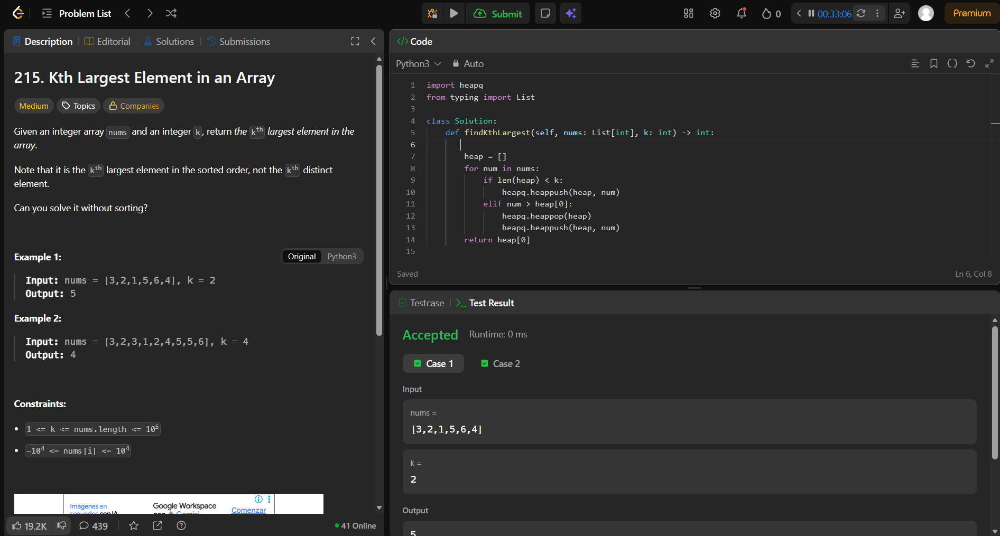
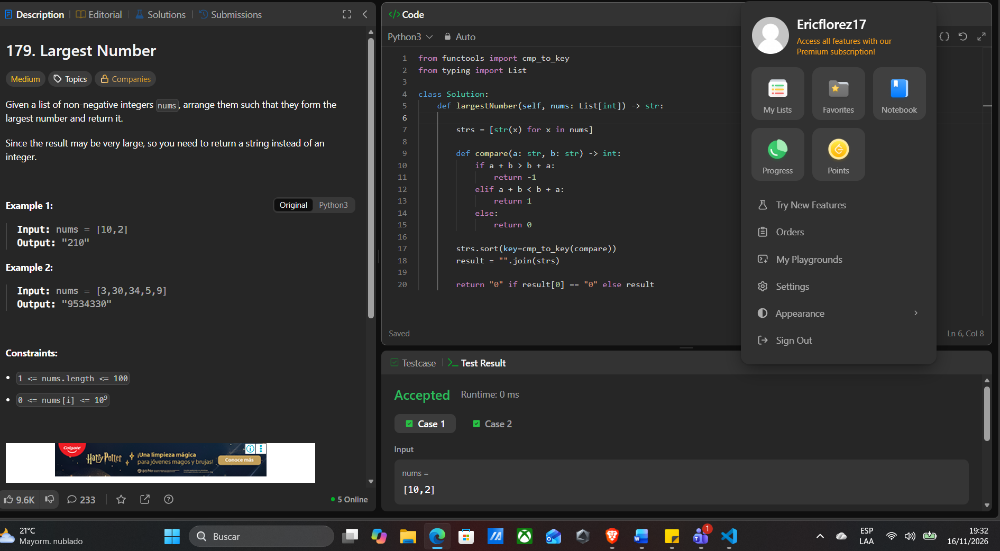
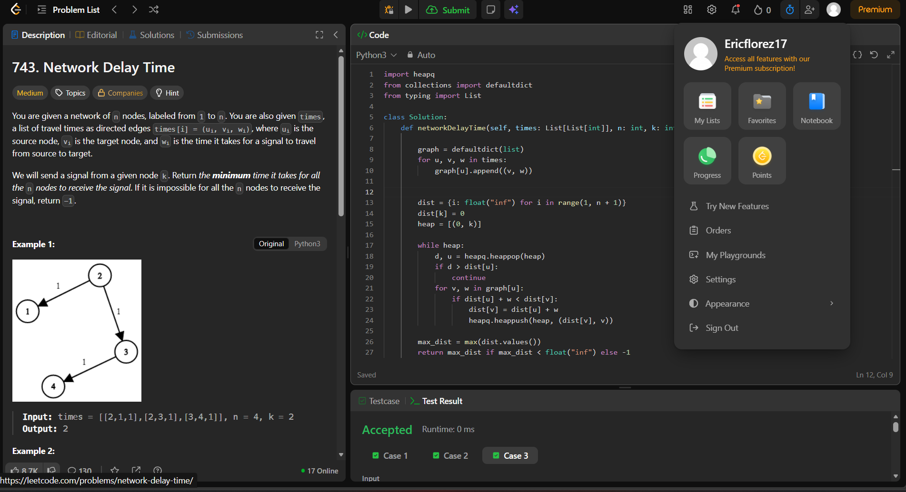
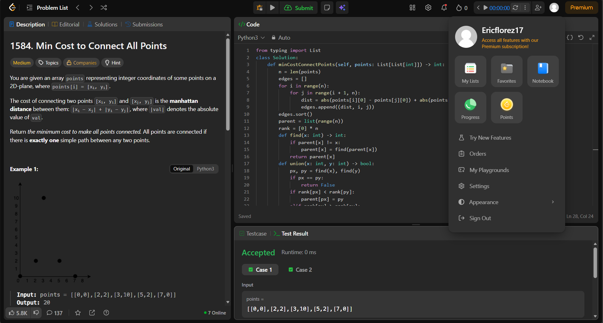

# Taller final · Análisis de algoritmos · ITM 2026-2

## Tabla de autoría

| Integrante                 | Ejercicios                          |
| -------------------        | ----------------------------------- |
| Eric David Florez Vasquez  | 215, 179, 743, 1584                 |
| Sebastian                  | 72, 300, 134, 79                    |

---

## 215. Kth Largest Element in an Array

**Autor:** Eric David Florez Vasquez   
**Familia:** heap  
**Idea:** Se mantiene un min-heap de tamaño exactamente `k`. Al recorrer el arreglo, si el heap aún no está lleno se inserta; si el nuevo valor es mayor que la raíz, se extrae la raíz y se inserta el nuevo. Al final la raíz es el k-ésimo mayor.  
**Complejidad:** Tiempo `O(n log k)`, espacio extra `O(k)`.

---

## 179. Largest Number

**Autor:** Tu Nombre Completo   
**Familia:** ordenamiento (clave)  
**Idea:** Se convierten los números a cadenas y se ordenan con un comparador que decide el orden según la concatenación: `a` va antes que `b` si `a + b > b + a`. Luego se unen las cadenas. Si el resultado empieza por cero se devuelve `"0"`.  
**Complejidad:** Tiempo `O(n log n · L)`, espacio `O(n)` (L = longitud media de las cadenas).

---

## 743. Network Delay Time

**Autor:** Tu Nombre Completo 
**Familia:** grafos (Dijkstra)  
**Idea:** Se modela el grafo dirigido y ponderado. Se ejecuta Dijkstra desde el nodo `k` usando un min-heap de distancias tentativas. La respuesta es la mayor distancia finita; si algún nodo queda inalcanzable se devuelve `-1`.  
**Complejidad:** Tiempo `O((n + m) log n)`, espacio `O(n + m)` (`m = times.length`).

---

## 1584. Min Cost to Connect All Points

**Autor:** Tu Nombre Completo 
**Familia:** grafos (MST – Kruskal)  
**Idea:** Se generan todas las aristas posibles con distancia Manhattan y se ordenan por peso. Con Union-Find se van agregando las aristas más baratas que no forman ciclo hasta conectar los `n` puntos.  
**Complejidad:** Tiempo `O(n² log n)`, espacio `O(n²)` (`n = points.length`).

