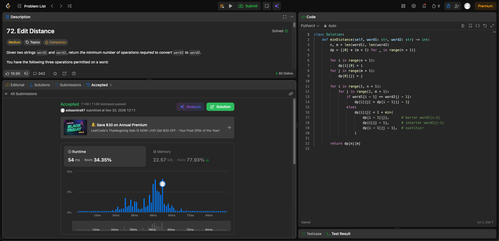
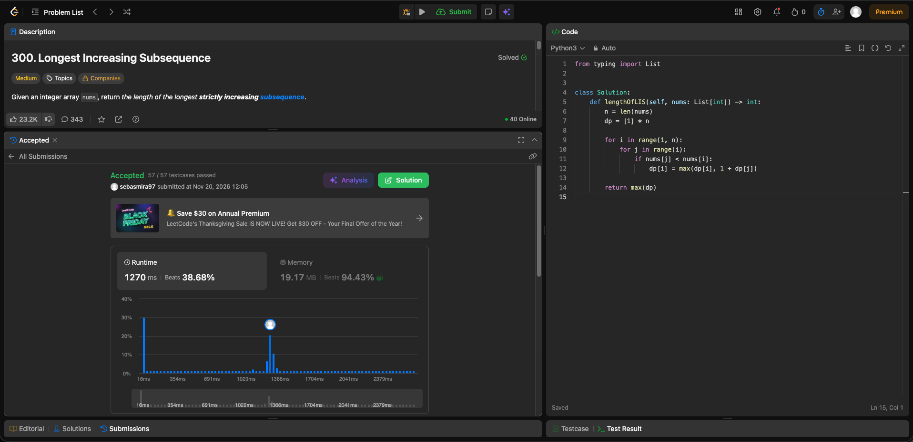
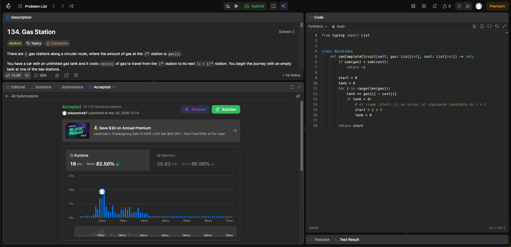
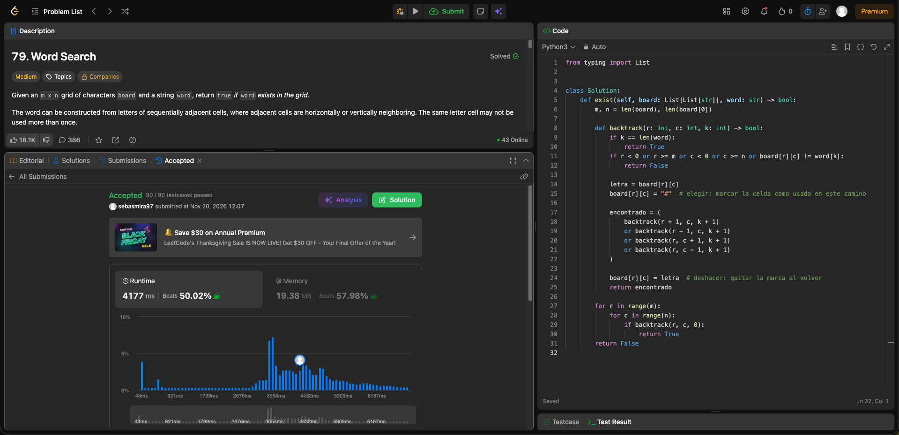

# Taller final · Análisis de algoritmos · ITM 2026-2

## Tabla de autoría

| Integrante | Usuario de git | Usuario de LeetCode | Ejercicios |
| --- | --- | --- | --- |
| Eric David Florez Vasquez | `David04042003` | Ericflorez17 | 215, 179, 743, 1584 |
| Sebastian Restrepo Mira | `Sebastian Restrepo Mira` | sebasmira97 | 72, 300, 134, 79 |

---

## 215. Kth Largest Element in an Array

Enlace: https://leetcode.com/problems/kth-largest-element-in-an-array/  
Código:  
**Autor:** Eric David Florez Vasquez (`David04042003`)  
**Familia:** heap  
**Idea:** Se mantiene un min-heap de tamaño exactamente `k`. Al recorrer el arreglo, si el heap aún no está lleno se inserta; si el nuevo valor es mayor que la raíz, se extrae la raíz y se inserta el nuevo. Al final la raíz es el k-ésimo mayor.  
**Complejidad:** Tiempo `O(n log k)`, espacio extra `O(k)` (`n = nums.length`).

---

## 179. Largest Number

Enlace: https://leetcode.com/problems/largest-number/  
Código:  
**Autor:** Eric David Florez Vasquez (`David04042003`)  
**Familia:** ordenamiento (clave)  
**Idea:** Se convierten los números a cadenas y se ordenan con un comparador que decide el orden según la concatenación: `a` va antes que `b` si `a + b > b + a`. Luego se unen las cadenas. Si el resultado empieza por cero se devuelve `"0"`.  
**Complejidad:** Tiempo `O(n log n · L)`, espacio `O(n)` (`n = nums.length`, `L` = longitud máxima de las cadenas).

---

## 743. Network Delay Time

Enlace: https://leetcode.com/problems/network-delay-time/  
Código: 
**Autor:** Eric David Florez Vasquez (`David04042003`)  
**Familia:** grafos (Dijkstra)  
**Idea:** Se modela el grafo dirigido y ponderado. Se ejecuta Dijkstra desde el nodo `k` usando un min-heap de distancias tentativas. La respuesta es la mayor distancia finita; si algún nodo queda inalcanzable se devuelve `-1`.  
**Complejidad:** Tiempo `O((n + m) log n)`, espacio `O(n + m)` (`n` nodos, `m = times.length`).

---

## 1584. Min Cost to Connect All Points

Enlace: https://leetcode.com/problems/min-cost-to-connect-all-points/  
Código:  
**Autor:** Eric David Florez Vasquez (`David04042003`)  
**Familia:** grafos (MST – Kruskal)  
**Idea:** Se generan todas las aristas posibles con distancia Manhattan y se ordenan por peso. Con Union-Find se van agregando las aristas más baratas que no forman ciclo hasta conectar los `n` puntos.  
**Complejidad:** Tiempo `O(n² log n)`, espacio `O(n²)` (`n = points.length`).

---

## 72. Edit Distance

Enlace: https://leetcode.com/problems/edit-distance/  
Código: [`edit-distance/solution.py`](edit-distance/solution.py)  
**Autor:** Sebastian Restrepo Mira (`Sebastian Restrepo Mira`)  
**Familia:** programación dinámica (tabla de Wagner–Fischer)  
**Estado:** `dp[i][j]` = mínimo de ediciones para convertir `word1[0..i)` en `word2[0..j)`.  
**Base:** `dp[i][0] = i` (borrar `i` letras) y `dp[0][j] = j` (insertar `j` letras).  
**Recurrencia:** si `word1[i−1] == word2[j−1]`, `dp[i][j] = dp[i−1][j−1]`; si no, `dp[i][j] = 1 + min(dp[i−1][j], dp[i][j−1], dp[i−1][j−1])` (borrar, insertar, sustituir). La respuesta es `dp[n][m]`.  
**Complejidad:** Tiempo `Θ(n·m)`, espacio `Θ(n·m)` (`n = word1.length`, `m = word2.length`).

---

## 300. Longest Increasing Subsequence

Enlace: https://leetcode.com/problems/longest-increasing-subsequence/  
Código: [`longest-increasing-subsequence/solution.py`](longest-increasing-subsequence/solution.py)  
**Autor:** Sebastian Restrepo Mira (`Sebastian Restrepo Mira`)  
**Familia:** programación dinámica  
**Estado:** `dp[i]` = longitud de la subsecuencia estrictamente creciente más larga que **termina** en el índice `i`.  
**Base:** `dp[i] = 1` (el elemento solo).  
**Recurrencia:** `dp[i] = max(dp[i], 1 + dp[j])` para todo `j < i` con `nums[j] < nums[i]`. La respuesta es `max(dp)`, no `dp[n−1]`, porque la LIS más larga puede no terminar en el último elemento.  
**Complejidad:** Tiempo `Θ(n²)`, espacio `Θ(n)` (`n = nums.length`).

---

## 134. Gas Station

Enlace: https://leetcode.com/problems/gas-station/  
Código: [`gas-station/solution.py`](gas-station/solution.py)  
**Autor:** Sebastian Restrepo Mira (`Sebastian Restrepo Mira`)  
**Familia:** greedy  
**Idea:** Si `sum(gas) < sum(cost)` es imposible y se devuelve `-1`. Si no, se recorre una vez acumulando `gas[i] − cost[i]` en un tanque. Cuando el tanque queda negativo al salir de `i`, se descarta todo el tramo `[inicio..i]`: cualquier estación de ese tramo llega a `i` con el mismo tanque o menos (empezar más adelante solo quita un prefijo que aportaba ≥ 0), así que ninguna sirve. El nuevo candidato es `i + 1` con el tanque en 0, y nunca hace falta volver atrás.  
**Complejidad:** Tiempo `Θ(n)`, espacio extra `Θ(1)` (`n = gas.length`).

---

## 79. Word Search

Enlace: https://leetcode.com/problems/word-search/  
Código: [`word-search/solution.py`](word-search/solution.py)  
**Autor:** Sebastian Restrepo Mira (`Sebastian Restrepo Mira`)  
**Familia:** backtracking  
**Idea:** Desde cada celda se lanza una búsqueda con estado `(fila, columna, k)`, donde `k` es la letra de `word` que toca. **Se elige** un vecino ortogonal (arriba, abajo, izquierda, derecha) cuya letra coincida con `word[k]`, se **marca** pisándolo con `#` para no reutilizarlo en el mismo camino, y se avanza a `k + 1`. Al volver de la rama **se deshace** la marca restaurando la letra original, para que otros caminos puedan usar esa celda. La diagonal no es vecina.  
**Complejidad:** Tiempo `O(m·n·4^L)` en el peor caso, espacio `O(L)` por la pila de recursión (grilla `m × n`, `L = word.length`).

